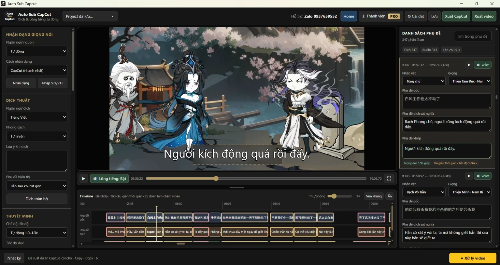

# AUTO SUB CAPCUT – GIẢI PHÁP DỊCH VIDEO VÀ LỒNG TIẾNG TỰ ĐỘNG

Chuyển video đa ngôn ngữ sang ngôn ngữ mong muốn, tự động dịch, lồng tiếng và đồng bộ thời gian. Tất cả chỉ với vài thao tác đơn giản, không cần mất hàng giờ chỉnh sửa thủ công.

*Giao diện Auto Sub CapCut: cài đặt bên trái, xem trước video đã lồng tiếng ở giữa, danh sách phụ đề bên phải. Mỗi câu có phụ đề gốc, bản dịch, nhân vật và giọng đọc riêng.*

*Kết quả trong CapCut sau khi dùng tool: một dự án dựng sẵn với phụ đề tiếng Việt, lớp che chữ gốc, video đã căn tốc độ và giọng lồng tiếng của từng câu, mỗi thứ nằm trên một hàng riêng. Mở ra là chỉnh tiếp được ngay.*

## TÍNH NĂNG NỔI BẬT

* **Dịch đa ngôn ngữ:** Hỗ trợ tiếng Trung, Anh, Nhật, Hàn, Việt...
* **Đồng bộ thời gian thông minh:** Tự tối ưu câu dịch, tìm cách diễn đạt ngắn hơn khi câu dịch quá dài, hạn chế lệch tiếng.
* **Tự nhận diện nhân vật và chọn giọng:** Tool tự nhận ra các nhân vật trong video và gán giọng nam/nữ phù hợp cho từng người. Bạn vẫn đổi giọng được cho từng nhân vật hoặc từng câu.
* **Nhiều giọng đọc tự nhiên:** Giọng thanh niên tự tin, cô gái hoạt ngôn, giọng nữ nhẹ nhàng ngọt ngào... cùng nhiều lựa chọn khác.
* **Che chữ gốc tự động:** Tự phát hiện vùng phụ đề trên video và chỉ che khi chữ xuất hiện.
* **Xuất dự án CapCut dựng sẵn:** Điểm khác biệt lớn nhất của tool. Không chỉ xuất video MP4, tool tạo sẵn cả một dự án CapCut hoàn chỉnh: phụ đề, lớp che chữ gốc, video đã căn tốc độ và từng câu lồng tiếng đều nằm đúng chỗ trên timeline. Mở trực tiếp trong CapCut để tiếp tục chỉnh sửa, dùng được cả mẫu chữ hiện từng chữ của CapCut.
* **Xuất MP4:** Có ngay video hoàn chỉnh để sử dụng.
* **Xử lý hàng loạt:** Dịch và lồng tiếng nhiều video cùng lúc.

## DỄ SỬ DỤNG – TỰ ĐỘNG HÓA TỐI ĐA

Không cần biết nhiều về dựng phim. Chỉ cần thêm video, chọn ngôn ngữ, giọng đọc và bấm xử lý. Tool sẽ tự động thực hiện các công đoạn còn lại.

## CHI PHÍ

* Dùng thử miễn phí 1 ngày.
* Gói Pro: **190.000đ / 30 ngày**.
* Cần API Key Gemini cho tính năng dịch AI (có video hướng dẫn).

**Cài đặt:** tải `Auto-Sub-Capcut-Setup-...exe` ở [bản mới nhất](https://github.com/pdhd97/Auto-Sub-CapCut/releases/latest) rồi chạy.
