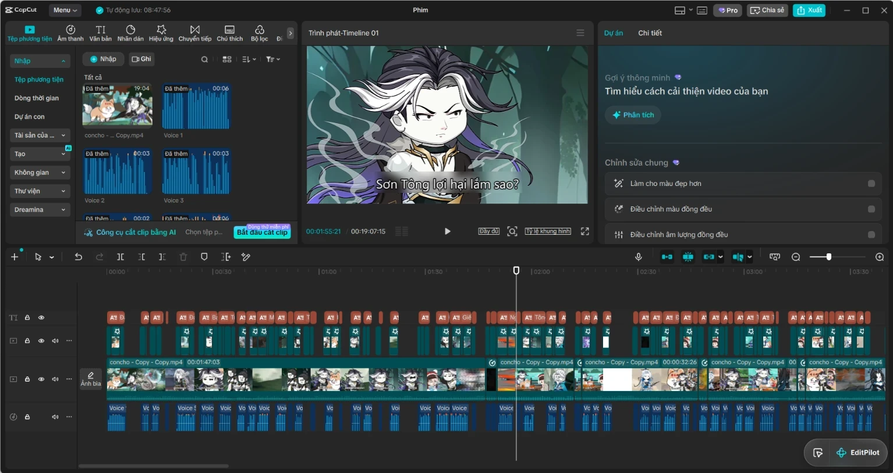

# AUTO SUB CAPCUT – GIẢI PHÁP DỊCH VIDEO VÀ LỒNG TIẾNG TỰ ĐỘNG

Chuyển video đa ngôn ngữ sang ngôn ngữ mong muốn, tự động dịch, lồng tiếng và đồng bộ thời gian. Tất cả chỉ với vài thao tác đơn giản, không cần mất hàng giờ chỉnh sửa thủ công.

**Tải về:** [bản mới nhất](https://github.com/pdhd97/Auto-Sub-CapCut/releases/latest), chọn file `Auto-Sub-Capcut-Setup-...exe` rồi chạy.

## TÍNH NĂNG NỔI BẬT

* **Dịch đa ngôn ngữ:** Hỗ trợ tiếng Trung, Anh, Nhật, Hàn, Việt...
* **Đồng bộ thời gian thông minh:** Tự tối ưu câu dịch, tìm cách diễn đạt ngắn hơn khi câu dịch quá dài, hạn chế lệch tiếng.
* **Nhiều giọng đọc tự nhiên:** Giọng thanh niên tự tin, cô gái hoạt ngôn, giọng nữ nhẹ nhàng ngọt ngào... cùng nhiều lựa chọn khác.
* **Che chữ gốc tự động:** Tự phát hiện vùng phụ đề trên video và chỉ che khi chữ xuất hiện.
* **Xuất dự án CapCut:** Mở trực tiếp trong CapCut để tiếp tục chỉnh sửa, không chỉ xuất video MP4.
* **Xuất MP4:** Có ngay video hoàn chỉnh để sử dụng.
* **Xử lý hàng loạt:** Dịch và lồng tiếng nhiều video cùng lúc.

## DỄ SỬ DỤNG – TỰ ĐỘNG HÓA TỐI ĐA

Không cần biết nhiều về dựng phim. Chỉ cần thêm video, chọn ngôn ngữ, giọng đọc và bấm xử lý. Tool sẽ tự động thực hiện các công đoạn còn lại.

## CHI PHÍ

* Dùng thử miễn phí 1 ngày.
* Gói Pro: **190.000đ / 30 ngày**.
* Cần API Key Gemini cho tính năng dịch AI (có video hướng dẫn).

Hỗ trợ Zalo: **0937659552**
